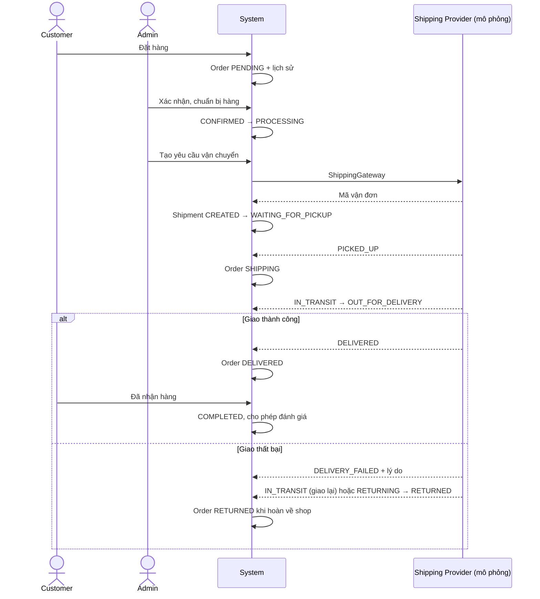
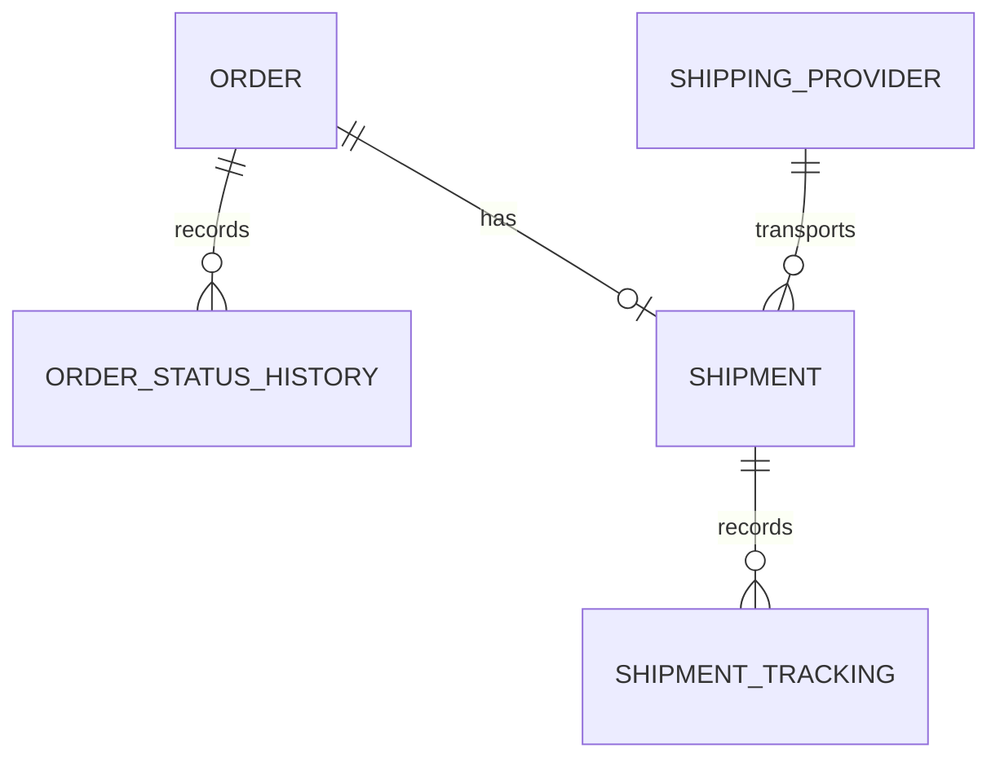

# Fashion Ecommerce

Tài liệu dự án được tập hợp từ các hướng dẫn thiết lập, triển khai, cơ sở dữ liệu, frontend, vận chuyển và kiểm thử.

## Mục lục

- [Getting Started](#getting-started)
- [OTP Setup](#otp-setup)
- [Performance Testing](#performance-testing)
- [Security Testing](#security-testing)
- [Shipping](#shipping)
- [Testing](#testing)
- [Deployment README](#deployment-readme)
- [Hướng dẫn cài đặt](#hướng-dẫn-cài-đặt)
- [Yêu cầu môi trường](#yêu-cầu-môi-trường)
- [Database README](#database-readme)
- [Archive Dataset Audit](#archive-dataset-audit)
- [Vietnamese Catalog Missing Images](#vietnamese-catalog-missing-images)
- [Arrow Image Repair Migration](#arrow-image-repair-migration)
- [Frontend README](#frontend-readme)

> **Phạm vi triển khai:** Các bước dưới đây chạy hệ thống demo trên máy local bằng Docker Compose và Spring Boot/Vite. Repo hiện chưa có cấu hình triển khai production (ví dụ: image backend/frontend, TLS/reverse proxy, secrets manager hoặc domain).
## HELP

_Source: `HELP.md`_

# Getting Started

### Required Environment Variables

Set `FASHION_JWT_SECRET` to a random value of at least 32 bytes before starting the application. Set `FASHION_ADMIN_PASSWORD` when the application should create or repair the local admin account; leave it empty in production to avoid automatic password management.

Optional: `FASHION_JWT_EXPIRATION_MS` controls JWT lifetime and defaults to 24 hours.

### Reference Documentation
For further reference, please consider the following sections:

* [Official Apache Maven documentation](https://maven.apache.org/guides/index.html)
* [Spring Boot Maven Plugin Reference Guide](https://docs.spring.io/spring-boot/4.1.1/maven-plugin)
* [Create an OCI image](https://docs.spring.io/spring-boot/4.1.1/maven-plugin/build-image.html)
* [Spring Web](https://docs.spring.io/spring-boot/4.1.1/reference/web/servlet.html)
* [Spring Data JPA](https://docs.spring.io/spring-boot/4.1.1/reference/data/sql.html#data.sql.jpa-and-spring-data)
* [Validation](https://docs.spring.io/spring-boot/4.1.1/reference/io/validation.html)
* [Spring Security](https://docs.spring.io/spring-boot/4.1.1/reference/web/spring-security.html)

### Guides
The following guides illustrate how to use some features concretely:

* [Building a RESTful Web Service](https://spring.io/guides/gs/rest-service/)
* [Serving Web Content with Spring MVC](https://spring.io/guides/gs/serving-web-content/)
* [Building REST services with Spring](https://spring.io/guides/tutorials/rest/)
* [Accessing Data with JPA](https://spring.io/guides/gs/accessing-data-jpa/)
* [Validation](https://spring.io/guides/gs/validating-form-input/)
* [Securing a Web Application](https://spring.io/guides/gs/securing-web/)
* [Spring Boot and OAuth2](https://spring.io/guides/tutorials/spring-boot-oauth2/)
* [Authenticating a User with LDAP](https://spring.io/guides/gs/authenticating-ldap/)

### Maven Parent overrides

Due to Maven's design, elements are inherited from the parent POM to the project POM.
While most of the inheritance is fine, it also inherits unwanted elements like `<license>` and `<developers>` from the parent.
To prevent this, the project POM contains empty overrides for these elements.
If you manually switch to a different parent and actually want the inheritance, you need to remove those overrides.


---

## OTP SETUP

_Source: `OTP_SETUP.md`_

# Email OTP setup

Registration now sends a six-digit email OTP. Accounts stay pending until the customer verifies the code. Codes expire after 10 minutes, can be resent after 60 seconds, and are invalidated after five incorrect attempts.

Configure an SMTP account in the backend environment before starting the application:

- `MAIL_HOST`: SMTP server hostname (defaults to Gmail SMTP)
- `MAIL_PORT`: SMTP submission port (defaults to `587`)
- `MAIL_USERNAME`: sender account email
- `MAIL_PASSWORD`: SMTP password or provider app password

Keep credentials in environment variables or a secrets manager; do not commit them. Without SMTP credentials, registration returns an error and does not create a usable account.

For local development, copy `.env.example` to `.env` and fill in your Gmail address and Google App Password. `.env` is ignored by Git, so the secret stays on your machine. Then start the backend with one command:

```powershell
if (-not (Test-Path .env)) { Copy-Item .env.example .env }
notepad .env
.\scripts\run-backend-current.ps1
```

Spring Boot now reads `MAIL_*` from `.env` automatically, so either the launcher or `.\\mvnw.cmd spring-boot:run` works from the project root. If registration still fails, check that the SMTP provider allows authenticated mail submission over STARTTLS on port 587. The API returns the SMTP configuration error instead of a generic HTTP 500.

---

## PERFORMANCE TESTING

_Source: `PERFORMANCE_TESTING.md`_

# Giai doan 6 - Performance testing

Chi chay JMeter sau khi functional va security regression da on dinh. Khong dung kich ban nay de day tai cuc lon neu NFR cua bao cao khong yeu cau.

## Test plan

File JMeter:

```text
performance/fashion-performance.jmx
```

Cay test plan:

```text
Test Plan
└── Thread Group
    ├── HTTP Request Defaults
    ├── HTTP Header Manager
    ├── Login
    ├── Products
    ├── Search
    ├── View Results Tree
    └── Summary Report
```

Endpoint mac dinh:

- `POST /api/auth/login`
- `GET /api/products`
- `GET /api/search?keyword=ao&page=0&size_param=10`

Tai khoan mac dinh lay theo `RoleInitializer`:

- Email: `customer@fashion.local`
- Password: `Customer@123`

## Chuan bi

1. Khoi dong database va backend Spring Boot o `http://localhost:8080`.
2. Neu can test thong qua frontend thi khoi dong them Vite, nhung JMeter plan nay ban vao backend API de do on dinh response time cua server:

```powershell
cd frontend
npm run dev
```

3. Mo JMeter GUI de kiem tra plan:

```powershell
jmeter -t performance/fashion-performance.jmx
```

## Chay nhe truoc

Nen chay non-GUI de ket qua it bi anh huong boi giao dien JMeter.

### 10 users

```powershell
jmeter -n -t performance/fashion-performance.jmx -l performance/results-10u.jtl -e -o performance/report-10u -Jthreads=10 -Jramp=10 -Jloops=5
```

### 50 users

```powershell
jmeter -n -t performance/fashion-performance.jmx -l performance/results-50u.jtl -e -o performance/report-50u -Jthreads=50 -Jramp=50 -Jloops=5
```

### 100 users

```powershell
jmeter -n -t performance/fashion-performance.jmx -l performance/results-100u.jtl -e -o performance/report-100u -Jthreads=100 -Jramp=100 -Jloops=5
```

Neu muon doi host/port:

```powershell
jmeter -n -t performance/fashion-performance.jmx -l performance/results-10u.jtl -Jhost=localhost -Jport=8080 -Jthreads=10 -Jramp=10 -Jloops=5
```

## Chi so can thu thap

Ghi lai cac cot sau tu Summary Report hoac HTML Dashboard:

| Run | Samples | Average | Median | P90 | P95 | Min | Max | Throughput | Error % |
| --- | ---: | ---: | ---: | ---: | ---: | ---: | ---: | ---: | ---: |
| 10 users / ramp 10s / loop 5 |  |  |  |  |  |  |  |  |  |
| 50 users / ramp 50s / loop 5 |  |  |  |  |  |  |  |  |  |
| 100 users / ramp 100s / loop 5 |  |  |  |  |  |  |  |  |  |

Quan trong nhat khi viet bao cao:

- Response Time: `Average`, `Median`, `P90`, `P95`
- Throughput
- Error Rate

## Cach doc ket qua

- PASS tot: `Error % = 0%` hoac rat gan 0%, P95 nam trong NFR cua bao cao.
- Can dieu tra: error tang khi len 50/100 users, P95 tang dot bien, hoac throughput khong tang khi tang users.
- Khong ket luan bug neu chi co mot spike don le. Can xem response code, backend log va co lap lai duoc khong.

## Mau nhan xet bao cao

```text
Voi muc 10 users, he thong xu ly on dinh, Error Rate dat ...%, P95 dat ... ms va Throughput dat ... req/s.
Khi tang len 50 users, P95 tang len ... ms, Throughput dat ... req/s, Error Rate ...%.
Khi tang len 100 users, he thong ... . Ket qua nay cho thay gioi han/chua thay gioi han trong pham vi NFR cua de tai.
```


---

## SECURITY TESTING

_Source: `SECURITY_TESTING.md`_

# Giai doan 5 - Security testing

Muc tieu: kiem tra cac yeu cau SEC-01..SEC-16 sau khi functional testing da on dinh.

## OWASP ZAP Automated Scan

1. Khoi dong backend Spring Boot o `http://localhost:8080`.
2. Khoi dong frontend:

```powershell
cd frontend
npm run dev
```

3. Mo OWASP ZAP bang ung dung desktop.
4. Chon `Automated Scan`.
5. Nhap URL:

```text
http://localhost:5173
```

6. Chay scan va ghi nhan tong so finding theo nhom `High`, `Medium`, `Low`, `Informational`.
7. Khong mac dinh coi moi finding cua ZAP la bug that. Can mo tung alert, kiem tra request/response, doi chieu code va danh dau `True positive`, `False positive`, hoac `Accepted risk`.

Trong moi truong terminal hien tai chua co lenh `zaproxy`/`zap.bat` trong PATH, nen ZAP can duoc mo bang desktop app.

## JUnit security regression

Chay rieng cac case security tu dong:

```powershell
.\mvnw.cmd "-Dtest=SecurityIntegrationTest" test
```

Ket qua gan nhat:

- `SecurityIntegrationTest`: 7 passed, 0 failed, 0 skipped.

## Security checklist

| ID | Hang muc | Ket qua / cach xac minh |
| --- | --- | --- |
| SEC-01 | HTTPS | Moi truong dev dung `http://localhost:5173`; production can bat HTTPS/TLS o reverse proxy hoac hosting. Backend da cau hinh HSTS header khi truy cap qua HTTPS. |
| SEC-02 | Password Hash | PASS tu dong: `sec02PasswordIsStoredAsBCryptHash` xac nhan password khong luu plain text, hash bat dau bang `$2`, va BCrypt verify duoc. |
| SEC-03 | SQL Injection | Can xac minh qua ZAP va test input doc hai. Code dang dung Spring Data JPA/repository parameter binding, khong thay ghep SQL truc tiep trong luong chinh. |
| SEC-04 | XSS | Can xac minh qua ZAP va UI manual. React mac dinh escape text render; can kiem tra cac truong review/search/profile voi payload `<script>alert(1)</script>`. |
| SEC-05 | CSP | PASS tu dong: `sec05AddsContentSecurityPolicyHeader` kiem tra header `Content-Security-Policy` co `default-src 'self'` va `frame-ancestors 'none'`. |
| SEC-06 | CSRF / co che tuong ung | PASS tu dong: `sec06CsrfUsesStatelessJwtBearerTokenInsteadOfSynchronizerToken` xac nhan API state-changing dung Bearer JWT stateless, khong phu thuoc session cookie CSRF token. |
| SEC-07 | RBAC | PASS tu dong: `sec07CustomerTokenCannotAccessAdminEndpoint` xac nhan CUSTOMER token goi `POST /api/admin/products` bi `403 Forbidden`. |
| SEC-08 | IDOR | PASS tu dong: `sec08CustomerCannotReadAnotherCustomersOrder` xac nhan Customer A truy cap order cua Customer B khong lay duoc du lieu. |
| SEC-09 | Invalid JWT | PASS tu dong: `sec09InvalidJwtCannotAccessProtectedEndpoint` xac nhan token sai khong truy cap duoc `/api/orders`. |
| SEC-10 | Expired JWT | PASS tu dong: `sec10ExpiredJwtCannotAccessProtectedEndpoint` xac nhan token het han khong truy cap duoc `/api/orders`. |
| SEC-11 | Login Rate Limit | Chua thay co rate limiting trong code hien tai. Nen bo sung bucket/token limit theo email/IP cho `/api/auth/login`, hoac cau hinh reverse proxy/API gateway. |
| SEC-12 | Upload file type | Can kiem tra khi co endpoint upload that. Review media hien tai dang nhan data URL; nen whitelist MIME/type neu cho upload file. |
| SEC-13 | Upload file size | Can kiem tra khi co endpoint upload that. Nen cau hinh max request/file size va validate kich thuoc base64/file. |
| SEC-14 | Transaction logging | Co lich su trang thai don hang `OrderStatusHistory` cho thay doi trang thai. Nen log them actor/userId, timestamp va hanh dong thanh toan neu can audit day du. |
| SEC-15 | Payment sensitive information | VNPay/payment flow khong nen log secret/card data. Can verify log runtime va response khong tra ve thong tin nhay cam. |
| SEC-16 | Backup/Restore | Co `backup.sql` trong repo. Can test restore vao database moi va ghi ket qua restore thanh cong/thoi gian restore. |

## Case authorization bat buoc

CUSTOMER token bi chan khoi admin API:

```text
CUSTOMER token -> POST /api/admin/products -> 403 Forbidden
```

IDOR don hang:

```text
Customer A token -> GET /api/orders/{orderId cua Customer B} -> khong tra ve du lieu don hang
```

Trong code hien tai case IDOR tra ve `400 Bad Request` voi thong bao don hang khong ton tai theo ngu canh user, chap nhan duoc ve mat khong lo du lieu. Neu muon dung dung tieu chi cua thay hon, co the doi handler/service sang `404 Not Found`.


---

## SHIPPING

_Source: `SHIPPING.md`_

# Luồng đơn hàng và vận chuyển

Hệ thống có Customer và Admin. GHN, GHTK, Viettel Post là dữ liệu đơn vị vận chuyển, không phải tài khoản hoặc role SHIPPER. Mỗi đơn hàng có tối đa một vận đơn.

## Chạy demo

Khởi động lại Spring Boot để tự chạy `shipping-migration.sql` trước khi Hibernate kiểm tra schema PostgreSQL. Migration tạo bảng mới, chỉ mục và ba đơn vị vận chuyển; chạy lặp lại được, không xóa dữ liệu hiện có. Dữ liệu lịch sử bắt đầu được ghi từ các thao tác mới, không tự bịa lịch sử cho đơn cũ.

1. Customer đặt hàng qua giỏ hàng hoặc mua ngay: PENDING và lịch sử đặt hàng.
2. Admin vào Quản lý đơn hàng, chọn đơn, xác nhận CONFIRMED rồi chuẩn bị PROCESSING.
3. Nhập đơn vị vận chuyển, khối lượng kg, phí và ngày dự kiến (tùy chọn), bấm Tạo đơn vận chuyển.
4. Bấm Bàn giao hàng (PICKED_UP). Simulator chạy mỗi 5 giây, đi lần lượt qua các điểm của tuyến đã lưu và tự chuyển IN_TRANSIT → OUT_FOR_DELIVERY → DELIVERED.
5. Customer vào Chi tiết đơn hàng để xem tuyến đường, xe và timeline; màn hình tự tải lại mỗi 5 giây khi đang chờ lấy hàng hoặc đang giao.
6. Sau DELIVERED, Customer bấm Đã nhận hàng để chuyển COMPLETED và mở đánh giá.
7. Có thể thử giao thất bại (bắt buộc lý do), giao lại hoặc hoàn về shop (RETURNED).

Phí trên vận đơn là phí của yêu cầu vận chuyển; tổng tiền khách đã chốt ở checkout không bị thay đổi. RETURNED ghi nhận kết quả hoàn hàng; hoàn tiền/kiểm đếm và nhập kho hàng hoàn cần nghiệp vụ xử lý riêng, không tự thực hiện tại callback.

## API

| Phương thức | Đường dẫn | Quyền |
| --- | --- | --- |
| GET | `/api/admin/shipping-providers` | Admin |
| GET / POST | `/api/admin/orders/{id}/shipment` | Admin: xem / tạo |
| PATCH | `/api/admin/orders/{id}/shipment/simulate` | Admin mô phỏng phản hồi ĐVVC |
| GET | `/api/orders/{id}/shipment` | Customer sở hữu đơn |
| PATCH | `/api/orders/{id}/receive` | Customer sở hữu đơn đã giao |

Tạo vận đơn: `{ "providerId": 1, "weightKg": 1.2, "shippingFee": 30000, "estimatedDelivery": "2026-09-25" }`.
Cập nhật: `{ "status": "DELIVERY_FAILED", "description": "Không liên hệ được người nhận", "location": "Hà Nội" }`.

`ShippingGateway` là điểm thay adapter mô phỏng bằng API hãng vận chuyển. Chưa kết nối API hãng thật; chưa công khai webhook. Callback thật sau này cần xác thực nguồn trước khi gọi nghiệp vụ cập nhật. Giao dịch tạo/cập nhật khóa đơn hàng để tránh tạo hai vận đơn hoặc cập nhật đồng thời; trạng thái lặp lại không tạo thêm sự kiện.

## Sơ đồ nghiệp vụ





## Kiểm tra

`mvn -Dtest=ShipmentFlowTest,AdminOrderServiceTest,OrderServiceTest,CheckoutServiceTest,OrderReceiptTest,ReviewEligibilityTest test`

`cd frontend` rồi `npm run build` và `npm run lint`.

`scripts/system-smoke-test.mjs` đã cập nhật để đi qua vận đơn và khách xác nhận nhận hàng, cần hệ thống demo đang chạy.

## Bản đồ, địa chỉ và tuyến đường thực

Checkout: nhập địa điểm → bấm Tìm kiếm/Enter → chọn kết quả để bản đồ bay tới zoom 17 → kéo bản đồ dưới ghim cố định → đợi địa chỉ → Xác nhận địa chỉ. Khi sửa địa chỉ hoặc di chuyển bản đồ, tọa độ đã xác nhận bị xóa để tránh đặt hàng với vị trí cũ. Có thể bấm Lấy địa chỉ tại ghim để chọn vị trí mặc định hoặc thử lại sau lỗi.

- `GET /api/location/search?q=...`: tìm địa chỉ tại Việt Nam, cần đăng nhập, 3–200 ký tự.
- `GET /api/location/reverse?lat=...&lng=...`: trả địa chỉ và giữ nguyên tọa độ người dùng đã chọn.
- Tracking trả thêm `route: [{latitude, longitude}, ...]`.
- Tạo vận đơn gọi OSRM một lần, lưu toàn bộ hình học GeoJSON theo thứ tự vào `shipment_route_points`. Không có tuyến hợp lệ thì tạo vận đơn thất bại và transaction rollback; không thay bằng đường thẳng.
- Simulator chỉ bắt đầu sau bàn giao; mỗi tick tiến một điểm. Các mốc IN_TRANSIT (10%), OUT_FOR_DELIVERY (80%), DELIVERED (100%) tính theo chỉ số điểm, không phải thời gian giao thực. Tuyến rất ngắn vẫn đi đủ các trạng thái qua nhiều tick. Giao thất bại/hoàn hàng không tự chạy.
- Vận đơn cũ thiếu tuyến không tự chạy. Admin cập nhật trạng thái tiếp theo sẽ lấy và lưu tuyến một lần; không tự bịa lại lịch sử.
- Khởi động lại backend để chạy migration tạo bảng tuyến. Schema trong `database/schema.sql` cũng đã được bổ sung.

### Cấu hình dịch vụ

| Biến môi trường | Mặc định | Công dụng |
| --- | --- | --- |
| `GEOCODING_PROVIDER` | `photon` | `photon` hoặc `nominatim` |
| `GEOCODING_URL` | `https://photon.komoot.io` | URL tương ứng với provider đã chọn |
| `ROUTING_URL` | `https://router.project-osrm.org` | OSRM hoặc máy chủ OSRM tự triển khai |
| `MAPS_USER_AGENT` | `FashionShopDemo/1.0` | Nên đặt tên ứng dụng kèm URL/email liên hệ khi triển khai |
| `SHIPPING_SIMULATOR_ENABLED` | `true` | Tắt mô phỏng khi tích hợp hãng thật |

Mặc định dùng [Photon](https://github.com/komoot/photon) cho tìm kiếm và reverse geocoding. Để dùng Nominatim, đặt cả `GEOCODING_PROVIDER=nominatim` và `GEOCODING_URL=https://nominatim.openstreetmap.org`, rồi khởi động lại backend. Các dịch vụ công cộng chỉ phù hợp demo ít người dùng: tìm kiếm bằng thao tác bấm, không autocomplete. Backend cache tối đa 1.000 kết quả trong 24 giờ, tuần tự hóa và giới hạn tối đa 1 request/1,1 giây cho toàn bộ tiến trình; yêu cầu vượt giới hạn nhận thông báo thử lại. Reverse geocoding debounce 750 ms và bỏ kết quả cũ khi người dùng di chuyển tiếp. Đây là giới hạn cho một instance; khi mở rộng nhiều instance cần provider riêng hoặc bộ giới hạn dùng chung. Không gửi tên/số điện thoại người nhận vào ô tìm địa điểm.

Tuân thủ [Nominatim usage policy](https://operations.osmfoundation.org/policies/nominatim/) và [OSM tile usage policy](https://operations.osmfoundation.org/policies/tiles/). Máy chủ demo công cộng không bảo đảm tính sẵn sàng; production nên dùng provider phù hợp. Routing theo [OSRM API](https://project-osrm.org/docs/v5.24.0/api/) (tọa độ nhà cung cấp là longitude, latitude).

Báo cáo: bản đồ, địa chỉ và tuyến đường là dữ liệu thực từ nhà cung cấp; vị trí xe được mô phỏng theo tuyến, chưa phải GPS của hãng vận chuyển.

Kiểm thử bổ sung: `mvn -Dtest=MapServicesTest,ShipmentFlowTest test`. Test dùng provider giả lập, không gọi dịch vụ bản đồ công cộng.


---

## TESTING

_Source: `TESTING.md`_

# Hướng dẫn kiểm thử

## JUnit backend

Yêu cầu: JDK 21 và kết nối Maven Central khi dependency chưa có trong cache.

Chạy toàn bộ test ở thư mục gốc:

```powershell
.\mvnw.cmd test
```

Chạy một lớp test:

```powershell
.\mvnw.cmd "-Dtest=VoucherServiceUnitTest" test
```

Các test JUnit dùng profile `test` và H2 trong bộ nhớ theo cấu hình
`src/test/resources/application-test.properties`, nên không cần PostgreSQL cho nhóm unit/integration test này.
Báo cáo Maven nằm trong `target/surefire-reports`.

## Playwright E2E functional testing

Mục tiêu giai đoạn 4 là chứng minh functional testing cho luồng:

```text
PostgreSQL -> Spring Boot Backend localhost:8080 -> React Frontend localhost:5173
```

Trước khi chạy E2E đầy đủ, cần bật PostgreSQL và backend Spring Boot. Frontend Vite sẽ được Playwright tự khởi động theo `frontend/playwright.config.js` nếu chưa có server ở `localhost:5173`.

Trên Windows PowerShell, dùng `npx.cmd` để tránh lỗi execution policy của `npx.ps1`:

```powershell
cd frontend
npx.cmd playwright --version
npx.cmd playwright test
npx.cmd playwright show-report
```

Nếu muốn chỉ xem log console gọn:

```powershell
npx.cmd playwright test --reporter=list
```

## Cấu trúc Playwright

```text
frontend/tests/
├── auth.spec.js
├── product.spec.js
├── search.spec.js
├── cart.spec.js
├── voucher.spec.js
├── checkout.spec.js
├── payment.spec.js
├── order.spec.js
├── shipping.spec.js
├── review.spec.js
├── wishlist.spec.js
├── smart-size.spec.js
└── admin.spec.js
```

Bộ E2E hiện có 45 functional cases:

- TC-01..TC-05: authentication, đăng ký, trùng email, đăng nhập, sai mật khẩu, validate form.
- TC-06..TC-13: product, search, detail, variant color/size, stock theo variant, quantity không vượt tồn.
- TC-14..TC-16: search/filter/sort/reset.
- TC-17..TC-20: cart add/increase/decrease/remove/empty state.
- TC-21..TC-22: voucher input và mã không hợp lệ.
- TC-23..TC-25: checkout form, validate dữ liệu, COD.
- TC-26..TC-27: payment method và payment return route.
- TC-28..TC-30: order list/profile/order detail missing id.
- TC-31..TC-32: shipping workflow và shipment context.
- TC-33..TC-35: review list, protected route, eligible/empty state.
- TC-36..TC-38: wishlist load/add/remove.
- TC-39..TC-41: smart size input hợp lệ, input biên, style recommendation.
- TC-42..TC-45: admin dashboard/products/inventory/orders.

Admin cases được skip nếu chưa cấu hình tài khoản admin. Để chạy nhóm này:

```powershell
$env:E2E_ADMIN_EMAIL="admin@fashion.local"
$env:E2E_ADMIN_PASSWORD="<admin-password>"
npx.cmd playwright test tests/admin.spec.js
```

Lần kiểm tra gần nhất trong môi trường này:

- `npx.cmd playwright --version`: `Version 1.63.0`
- `npx.cmd playwright test --reporter=list`: 41 passed, 4 skipped admin cases do chưa set `E2E_ADMIN_PASSWORD`.
- Lưu ý: runner đã in đủ các dòng `ok` cho 41 case và 4 dòng skip, nhưng tiến trình bị kẹt ở bước cleanup/report nên đã được ngắt bằng `Ctrl+C`.


---

## README

_Source: `03_Deployment/README.md`_

# Fashion Deployment

Thu muc nay chua tai lieu va tep cau hinh mau de cai dat, chay va trien khai he thong Fashion.

## Noi dung

- `HUONG_DAN_CAI_DAT.md`: Huong dan cai dat va chay he thong theo tung buoc.
- `YEU_CAU_MOI_TRUONG.md`: Danh sach phan mem, cong cu va cong dich vu can co.
- `docker-compose.yml`: Tep Docker Compose dung de khoi dong PostgreSQL, Redis, Elasticsearch va RabbitMQ.
- `.env.example`: Cac bien moi truong mau, khong chua thong tin bi mat that.
- `config/application-example.properties`: Cau hinh backend Spring Boot mau.
- `config/frontend-env.example`: Cau hinh frontend Vite mau.

## Trinh tu trien khai nhanh

1. Cài các công cụ trong phần [Yêu cầu môi trường](#yêu-cầu-môi-trường).
2. Khởi động các dịch vụ phụ trợ bằng Compose từ thư mục `03_Deployment`.
3. Cấu hình biến backend bằng environment variables; file `.env.example` trong `03_Deployment` là mẫu tham khảo và Docker Compose không tự nạp nó cho tiến trình Spring Boot.
4. Chạy backend Spring Boot và frontend Vite theo các bước bên dưới.
5. Chạy kiểm thử bằng `.\mvnw.cmd test` từ thư mục gốc.

Khong dua mat khau that, JWT secret that, VNPay secret that hoac thong tin nhay cam vao thu muc nop.


---

## HUONG DAN CAI DAT

_Source: `03_Deployment/HUONG_DAN_CAI_DAT.md`_

# HUONG DAN CAI DAT HE THONG FASHION

## 1. Yeu cau moi truong

- Java 21
- Node.js va npm
- Maven hoac Maven Wrapper cua du an
- Docker Desktop va Docker Compose
- Git

Chi tiet xem `YEU_CAU_MOI_TRUONG.md`.

## 2. Lay ma nguon

```powershell
git clone <repository-url>
cd fashion
```

Neu da co source code, mo terminal tai thu muc goc du an.

## 3. Cau hinh moi truong

Tham khảo các tệp mẫu:

- `03_Deployment/.env.example` (mẫu tham khảo; không được Compose tự nạp)
- `03_Deployment/config/application-example.properties` (mẫu thuộc tính; Spring Boot không tự đọc tệp này)
- `03_Deployment/config/frontend-env.example`

Không dùng secret thật trong tệp mẫu hoặc commit secret. Ứng dụng đọc cấu hình database qua `SPRING_DATASOURCE_URL`, `SPRING_DATASOURCE_USERNAME`, `SPRING_DATASOURCE_PASSWORD`; JWT qua `FASHION_JWT_SECRET`; và các cấu hình khác qua biến `SPRING_*`/`FASHION_*` tương ứng. `DB_*` trong `.env.example` không phải tên biến mà cấu hình Spring hiện tại đọc.

## 4. Khoi dong cac dich vu Docker

Compose file nằm trong `03_Deployment`. Chạy các lệnh sau từ thư mục gốc:

```powershell
docker compose -f 03_Deployment/docker-compose.yml up -d --wait
```

Kiem tra trang thai:

```powershell
docker compose -f 03_Deployment/docker-compose.yml ps
```

He thong Docker khoi dong cac dich vu phu tro:

- PostgreSQL
- Redis
- Elasticsearch
- RabbitMQ

Compose dùng thông tin PostgreSQL demo `fashion/fashion`, tạo schema từ `database/schema.sql` khi volume database được khởi tạo lần đầu. Giá trị này không dành cho production. `spring.cache.type` mặc định là `simple`, nên Redis hiện không cần cho đường chạy mặc định; RabbitMQ được kết nối bởi ứng dụng.

## 5. Chay Backend

Từ thư mục gốc, đặt `SPRING_DATASOURCE_URL`, `SPRING_DATASOURCE_USERNAME`, `SPRING_DATASOURCE_PASSWORD`, và `FASHION_JWT_SECRET` trong môi trường. Dùng mật khẩu admin/customer riêng cho môi trường cần triển khai. Nếu dùng đăng ký email, cấu hình thêm `MAIL_HOST`, `MAIL_PORT`, `MAIL_USERNAME`, `MAIL_PASSWORD` trong `.env` (script bên dưới chỉ nạp các biến `MAIL_*` từ `.env`). Sau đó chạy:

```powershell
.\scripts\run-backend-current.ps1
```

Neu dung Maven cai san:

```powershell
Set-Location <project-root>
.\mvnw.cmd spring-boot:run
```

Backend mac dinh chay tai:

```text
http://localhost:8081
```

## 6. Chay Frontend

```powershell
cd frontend
npm install
npm run dev
```

Mo dia chi Vite hien thi tren terminal, thong thuong:

```text
http://localhost:5173
```

## 7. Tai khoan mau

| Vai tro | Email | Mat khau |
| --- | --- | --- |
| Admin | admin@fashion.local | Admin@123 |
| Khach hang | customer@fashion.local | Customer@123 |

## 8. Chay kiem thu Backend

Tai thu muc goc du an:

```powershell
.\mvnw.cmd test
```

Ket qua kiem thu gan nhat:

```text
Tests run: 88
Failures: 0
Errors: 0
Skipped: 0
BUILD SUCCESS
```

## 9. Dừng hệ thống Docker

```powershell
docker compose -f 03_Deployment/docker-compose.yml down
```

Lệnh này dừng và xóa container, giữ lại volume dữ liệu Docker. Không dùng `down -v` trừ khi chủ động muốn xóa dữ liệu demo.


---

## YEU CAU MOI TRUONG

_Source: `03_Deployment/YEU_CAU_MOI_TRUONG.md`_

# YEU CAU MOI TRUONG

## 1. Phan mem can cai dat

| Thanh phan | Phien ban khuyen nghi | Muc dich |
| --- | --- | --- |
| Java JDK | 21 | Chay backend Spring Boot |
| Maven | 3.9+ hoac Maven Wrapper | Build va test backend |
| Node.js | 20+ | Chay frontend React/Vite |
| npm | Di kem Node.js | Cai dependency frontend |
| Docker Desktop | Ban moi on dinh | Chay PostgreSQL, Redis, Elasticsearch, RabbitMQ |
| Docker Compose | Di kem Docker Desktop | Quan ly cac service Docker |
| Git | Ban moi on dinh | Clone source code |

## 2. Cong mac dinh

| Dich vu | Cong |
| --- | --- |
| Backend Spring Boot | 8081 |
| Frontend Vite | 5173 |
| PostgreSQL | 5432 |
| Redis | 6379 |
| Elasticsearch | 9200 |
| RabbitMQ | 5672 |
| RabbitMQ Management UI | 15672 |

Truoc khi chay, can dam bao cac cong tren chua bi ung dung khac chiem dung.

## 3. Bien moi truong quan trong

- `FASHION_ADMIN_PASSWORD`
- `FASHION_CUSTOMER_PASSWORD`
- `FASHION_JWT_SECRET`
- `GROQ_API_KEY` (optional; enables Groq-powered stylist chat)
- `GROQ_MODEL` (optional; defaults to `llama-3.3-70b-versatile`)
- `VNPAY_TMN_CODE`
- `VNPAY_HASH_SECRET`
- `VNPAY_RETURN_URL`
- `VNPAY_FRONTEND_RETURN_URL`
- `GEOCODING_PROVIDER`
- `GEOCODING_URL`
- `ROUTING_URL`
- `MAPS_USER_AGENT`
- `SHIPPING_SIMULATOR_ENABLED`
- `VITE_CARTO_API_KEY`

Khong commit hoac nop secret that. Chi su dung gia tri mau trong tai lieu.

## 4. Ghi chu

- Lan dau chay Maven co the can internet de tai dependency tu Maven Central.
- Lan dau chay `npm install` can internet de tai package frontend.
- Docker Desktop phai dang chay truoc khi thuc hien `docker compose up`.


---

## README

_Source: `database/README.md`_

# Demo data generators

These scripts add deterministic demo data without deleting existing rows. They are intended to run only after PostgreSQL schema initialization and application migrations are stable.

## Install

```powershell
python -m pip install -r database/requirements.txt
```

## Run all generators

```powershell
python database/generate_all.py
```

The order is collections, products and variants, users, then reviews. Individual scripts are also available:

```powershell
python database/generate_collections.py
python database/generate_products.py
python database/generate_users.py
python database/generate_reviews.py
```

Targets are minimum row counts:

- 50 collections
- 3,000 products
- 15,000 variants
- 10 users
- 30,000 reviews

The scripts use `FASHION_DB_HOST`, `FASHION_DB_PORT`, `FASHION_DB_NAME`, `FASHION_DB_USER`, and `FASHION_DB_PASSWORD` when supplied; otherwise they use the local development PostgreSQL settings. Existing rows are preserved and duplicate natural keys are ignored.

`generate_reviews.py` requires users and products to exist first. Demo users use `FASHION_DEMO_PASSWORD_HASH`; set it to a valid bcrypt hash before using generated accounts to log in.

The Vietnamese demo catalog seed was removed.

## Optional 1,000-item fashion dataset sample

The supplied `archive.zip` can be converted into a deterministic, idempotent demo seed with 1,000 distinct product IDs and 1,000 distinct display names. It copies the selected 60×80 source thumbnails into `frontend/public/assets/products/myntra-sample/`, creates `database/seed_myntra_demo.sql` plus an image/source manifest, and adds a marked generated block to `database/seed.sql`.

```powershell
python database/build_myntra_demo_seed.py E:\archive.zip
```

After schema initialization and application migrations, the usual `database/seed.sql` now includes this catalog. To apply or refresh only the sample block against an existing database, run:

```powershell
psql -U fashion -d fashion -v ON_ERROR_STOP=1 -f database/seed_myntra_demo.sql
```

The generated block does not delete existing rows. It creates separate dataset categories and a technical `Dataset Sample` brand. The source does not provide Fashion Shop prices, stock or size variants, so the seed generates clearly labeled demo values; do not treat them as real offers. The source thumbnails are 60×80 and unsuitable as production product photography. See `frontend/public/assets/products/myntra-sample/ATTRIBUTION.md` before distributing or deploying these sample assets.


---

## archive dataset audit

_Source: `database/archive_dataset_audit.md`_

# Audit `E:\archive.zip`

## Kết quả kiểm tra

- Archive chứa bộ dữ liệu ảnh sản phẩm thời trang Myntra (dấu hiệu: `styles.csv`, `images/<id>.jpg`, metadata `masterCategory`, `articleType`, `productDisplayName`).
- Có 44.446 dòng metadata và 44.446 ID riêng; hai thư mục ảnh (`images/` và `myntradataset/images/`) là hai bản giống hệt nhau, mỗi bản có 44.441 ảnh. 5 ID metadata không có ảnh trong archive.
- Ảnh mẫu là JPEG 60×80 px. Kích thước này quá nhỏ để dùng làm ảnh sản phẩm hiển thị rõ trên catalog; phóng to không khôi phục chi tiết.
- ZIP không kèm README, file license hoặc attribution; CSV chỉ có metadata sản phẩm.
- Metadata gồm các trường giới tính, nhóm danh mục, loại mặt hàng, màu, mùa, năm, mục đích sử dụng và tên hiển thị. Nó mô tả hàng hóa của bên thứ ba, không có giá/stock/variant đủ tin cậy để tạo listing trong Fashion Shop.

## Quyết định tích hợp

Kaggle hiện hiển thị MIT cho dataset bản nhỏ `Fashion Product Images (Small)`, khớp với thumbnail 60×80 trong archive này: https://www.kaggle.com/paramaggarwal/fashion-product-images-small. Theo yêu cầu của chủ dự án, đã tạo một subset development/demo có attribution và tách biệt khỏi catalog gốc.

Giới hạn quyền vẫn cần lưu ý: Myntra xác nhận ảnh và văn bản trên platform được bảo vệ và hạn chế sao chép/phân phối nếu chưa có chấp thuận bằng văn bản: https://www.myntraglobal.com/pages/terms-of-use. Kaggle cũng nói license listing là thông tin do người đăng cung cấp, người dùng tự kiểm tra điều khoản. Do đó seed này phù hợp làm fixture demo theo yêu cầu chủ dự án; chưa có căn cứ xác nhận quyền thương mại của từng ảnh gốc. Không xem đây là bằng chứng rằng ảnh đã được cleared cho storefront sản phẩm thật.

Subset seed giữ attribution, ảnh gốc và tên mẫu; giá, tồn kho, lựa chọn size do seed tạo là dữ liệu demo. Để dùng storefront thương mại, cần xác nhận quyền ảnh và nội dung hoặc thay bằng ảnh tự chụp/ảnh stock được cấp phép và metadata do Fashion Shop sở hữu.

## Đối chiếu category ở mức khái niệm

| Nhóm trong archive | Gợi ý nhóm taxonomy Fashion Shop |
|---|---|
| Apparel / Topwear | Áo, áo thun, áo sơ mi, áo khoác, áo len |
| Apparel / Bottomwear | Quần, quần jean, quần short, chân váy |
| Apparel / Saree, Ethnic, Kurtas | Trang phục truyền thống / Việt phục chỉ khi mặt hàng thực sự là trang phục Việt |
| Footwear | Giày, sneaker, boots, sandal, dép |
| Accessories / Bags, Wallets, Belts, Watches, Eyewear, Jewellery | Túi, ví, thắt lưng, đồng hồ, kính, trang sức |
| Innerwear, Personal Care | Chỉ ánh xạ nếu cửa hàng có danh mục và nghiệp vụ tương ứng |

Đây là gợi ý phân loại, không phải lệnh tự tạo danh mục hoặc sản phẩm. Nguồn dữ liệu tập trung vào thị trường/nhãn hàng Ấn Độ; không nên gán các dòng `Ethnic`, `Saree` hoặc `Kurtas` thành Việt phục.

## Subset đã nạp cho môi trường demo

- `database/seed_myntra_demo.sql` là seed idempotent riêng; `database/seed.sql` cũng có khối được đánh dấu để nạp lại cùng subset khi khởi tạo database.
- Script tạo dữ liệu: `database/build_myntra_demo_seed.py`.
- Manifest: `frontend/public/assets/products/myntra-sample/manifest.json`; attribution: `frontend/public/assets/products/myntra-sample/ATTRIBUTION.md`.
- Đã nạp vào PostgreSQL local `fashion` trên `127.0.0.1:5432`: 1.000 sản phẩm, 8 danh mục (125 sản phẩm/danh mục), 1.000 ảnh liên kết; 0 bản ghi thiếu ảnh, 0 tên trùng, 0 file ảnh trùng SHA-256.
- Giá, stock, và size là dữ liệu demo tổng hợp; không đại diện cho giá hay biến thể gốc.


---

## VIETNAMESE CATALOG MISSING IMAGES

_Source: `database/VIETNAMESE_CATALOG_MISSING_IMAGES.md`_

# Vietnamese catalog images: unresolved local assets

Status: BLOCKED for image restoration. The three local paths below are referenced by `database/seed_vietnamese_catalog.sql`, but the expected files are absent from this checkout. No replacement image was selected.

| Product ID | Seed slug | Expected local path | Existing source evidence |
| --- | --- | --- | --- |
| 984 | `viet-phuc-ao-tac-nu-demo` | `/assets/products/vietnamese-traditional/ao-tac/viet-phuc-ao-tac-nu-demo/main.webp` | `database/download_vietnamese_catalog_images.py` maps this slug to Wikimedia `File:Rio m? ch?u ?o t?c.jpg`, creator Ptdtch, CC BY-SA 4.0. |
| 997 | `ao-ba-ba-nu-demo` | `/assets/products/vietnamese-traditional/ao-ba-ba/ao-ba-ba-nu-demo/main.webp` | The downloader maps this slug to Wikimedia `File:Vietnam 2011.jpg`, creator 4bangoai, CC BY-SA 4.0. |
| 990 | `ao-dai-nu-co-dien-demo` | `/assets/products/vietnamese-traditional/ao-dai/ao-dai-nu-co-dien-demo/main.webp` | The downloader maps this slug to Wikimedia `File:?o d?i, H? G??m.jpg`, creator tq2cute, CC BY 2.0. |

The attribution and source URLs are also recorded in the historical seed. The download script is present in commit `e4b76252f717f00143b46b6276d4ff5aa5952fef`. The files are not present under `frontend/public/assets/products/vietnamese-traditional`, and no corresponding manifest was found. Outbound HTTP checks to Wikimedia were blocked by the current Windows environment (`WinError 10013`), so current source-page availability and image content could not be independently revalidated in this run.

Next safe step: run `python database/download_vietnamese_catalog_images.py` in an environment with outbound access to Wikimedia, inspect the generated images and `frontend/public/assets/vietnamese-batch-01-manifest.json`, then verify the checked-in seed paths resolve to the downloaded files. This script creates source JPEG and optimized WebP files plus attribution metadata; review its generated artifacts before applying them. Keep the image-integrity test failing until those specific assets are verified and present.


---

## README arrow image repair

_Source: `database/migrations/README-arrow-image-repair.md`_

# Arrow catalog repair

The Arrow product seed values were restored from commit `8e9fc73d360043e10418d1c60d947bfb04fd13c4` (product name, slug, demo prices, gender/flags, two variant SKUs and their sizes/stock, category, and image-to-M variant relationship). The corrected long image path is present in the following historical seed revision and matches the local manifest's dataset ID `18896` and SHA-256.

## Backup and inspect

Before a production write, save a full PostgreSQL backup with a locally installed PostgreSQL client:

```powershell
$env:PGPASSWORD = 'fashion'
pg_dump -h 127.0.0.1 -U fashion -d fashion -Fc -f database/backups/fashion-before-arrow-image-repair.dump
```

Use a protected backup directory and a database-specific credential in non-demo environments. Confirm the output file exists and is non-empty before continuing. The migration itself checks product identity, both historical variant tuples, SKU ownership and exactly one primary image attached to the M variant. It changes only `product_images.image_url` and `alt_text`; IDs and foreign keys remain unchanged. It is safe to rerun after success.

```powershell
$env:PGPASSWORD = 'fashion'
psql -h 127.0.0.1 -U fashion -d fashion -v ON_ERROR_STOP=1 -f database/migrations/20261022_repair_arrow_product_image.sql
```

The migration raises an exception before writing if the live rows do not match the verified snapshot.

## Restore if required

Restore the full backup to a separate database for review:

```powershell
createdb -h 127.0.0.1 -U fashion fashion_arrow_recovery
pg_restore -h 127.0.0.1 -U fashion -d fashion_arrow_recovery database/backups/fashion-before-arrow-image-repair.dump
```

Do not restore over a live database without a separately reviewed recovery plan.


---

## README

_Source: `frontend/README.md`_

# React + Vite

This template provides a minimal setup to get React working in Vite with HMR and some Oxlint rules.

Currently, two official plugins are available:

- [@vitejs/plugin-react](https://github.com/vitejs/vite-plugin-react/blob/main/packages/plugin-react) uses [Oxc](https://oxc.rs)
- [@vitejs/plugin-react-swc](https://github.com/vitejs/vite-plugin-react/blob/main/packages/plugin-react-swc) uses [SWC](https://swc.rs/)

## React Compiler

The React Compiler is not enabled on this template because of its impact on dev & build performances. To add it, see [this documentation](https://react.dev/learn/react-compiler/installation).

## Expanding the Oxlint configuration

If you are developing a production application, we recommend using TypeScript with type-aware lint rules enabled. Check out the [TS template](https://github.com/vitejs/vite/tree/main/packages/create-vite/template-react-ts) for information on how to integrate TypeScript and Oxlint's TypeScript related rules in your project.
